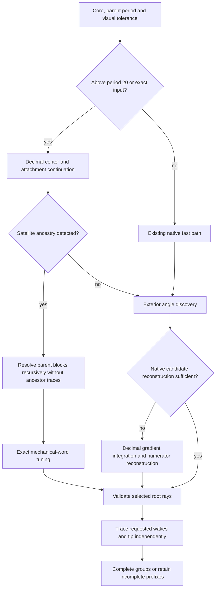

# Higher-period parameter rays

The current attempted parent-period range is **1–32**, controlled by
`MAX_PARAMETER_PERIOD` in `FractoParameterPrecision.js`. The former period-20
cap was an implementation policy. Raising it requires coordinated precision,
angle discovery, endpoint validation, runtime and UI changes; changing just an
input guard is insufficient. Period 32 is a conservative next ceiling, not a
claim that all components up to that period will resolve.

## Published basis

- John Milnor, _Periodic Orbits, External Rays and the Mandelbrot Set: An
  Expository Account_, Astérisque 261 (2000), 277–333,
  [sections 6, 8 and Appendix B](https://numdam.org/item/AST_2000__261__277_0/):
  multipliers, satellite structure, binary tuning and rotation sequences.
- Dierk Schleicher, _Rational parameter rays of the Mandelbrot set_,
  Astérisque 261 (2000), 405–443,
  [published article](https://numdam.org/item/AST_2000__261__405_0/):
  rational parameter-ray landing and associated dynamics.
- Roland Bulirsch and Josef Stoer, _Numerical treatment of ordinary differential
  equations by extrapolation methods_, Numerische Mathematik 8 (1966), 1–13,
  [published article](https://doi.org/10.1007/BF02165234): numerical context for
  modified-midpoint extrapolation. Our polynomial extrapolation table and its
  work/error policies are an implementation choice, not the full historical
  algorithm or a theorem about the Green-gradient equation.
- [Romera et al. (2013), article 105283](https://doi.org/10.1155/2013/105283)
  discusses finite-arithmetic limitations in external-ray drawing. We do not
  use its Bezier interpolation fallback.

These references motivate the mathematical objects and numerical methods;
our tolerances, precision thresholds and time limits are engineering choices.

## Precision policy and coordinates

`parameter_math` provides isolated Decimal complex arithmetic contexts. It
uses the existing decimal.js dependency rather than changing global Decimal
settings. `parameter_digits(P)` selects max(80,40+ceil(0.7P)) digits; within
the current range the high-precision path therefore uses 80 digits. Native
calculations remain the fast path for ordinary periods through 20. Periods
above 20, decimal-string cores and explicitly exact coordinates use Decimal
attachment calculations; inherited parent coordinates retain the same policy.

`{x,y}` numeric inputs remain compatible. String coordinates can retain more
input digits. Refined points contain numeric `x,y` for existing geometry plus
`exact: {x: string,y: string}` and `precision` for subsequent calculations.
Once an input has been rounded to Number, extra digits cannot be recovered;
center refinement finds a nearby root but cannot establish which component
the caller intended if the original input is ambiguous.

Reference-cache keys include exact coordinates and precision. The tracer reads
exact strings for its reference orbit; it does not silently replace them with
the projected numeric fields. Distances used by core-movement guards also use
exact coordinates. Final canvas polylines are still numeric coordinates and
raster rendering has its existing precision limits. This change expands the
ray generator's period range, not the entire renderer's arbitrary-zoom support.
The existing minimum requested tolerance 1e-12 is unchanged.

## Endpoints and ancestry

`FractoParameterBigAttachment.js` mirrors center refinement and the coupled
periodic-point/multiplier continuation in Decimal arithmetic. It uses 64
continuation stages, up to 160 Newton updates per stage, and precision-scaled
residual checks. Supported thirds recompute sqrt(3)/2 with Decimal arithmetic.
The root target is 1-10^(-ceil(digits/3)), or 1-1e-27 at 80 digits, avoiding
the exact singular boundary while approaching much closer than the native
1-1e-6 target. Cusp-direction extrapolation remains separate from tangent
probing at ordinary satellite attachments.

`FractoParameterParent.js` checks proper divisors of the selected period at
the computed root. It solves the lower-period periodic-point equation, tests
a unit multiplier with coprime rotation p/q, and continues that multiplier
back to zero to identify a parent center. This is a numerical ancestry check,
not proof of combinatorial classification.

`FractoParameterRootAngles.js` recursively obtains the parent's binary blocks.
`rotation_words` builds the mechanical p/q word, sorts its distinct cyclic
rotations and takes the closest binary pair. Exact block substitution then
gives candidate characteristic angles for the selected component. For example,
2/3 uses 101,110; 2/5 uses 01001,01010. This works across satellite periods,
not a registry of selected cardinalities or coordinates.

Ancestors supply candidate angle blocks without retracing every ancestor's
rays. The selected component's candidates must still have the expected exact
doubling period and its final root rays must reach the checked root. Only that
completed root access can feed the selected component's other wake/tip groups.
A primitive component without detected satellite ancestry uses exterior angle
integration instead. This distinction avoids redundant slow ancestor traces.

`FractoParameterBigTip.js` refines the preperiodic tip with Decimal critical
iterates and derivatives, checking the return relation, repelling multiplier
and nonperiodic critical transition. It preserves the exact target for tracing.
The ordinary native tip path remains available at lower periods.

The main-thread elapsed indicator remains responsive throughout these worker
stages, including the slow fallback. Only completed selected-root access can
feed exact angles into the subsequent groups.

## Exterior angles and ray tracing

Native angle discovery is attempted through 32 angular bits when its probe
geometry is resolvable. Higher-period native searches can use 48 probes per
side instead of 16. Failed high-precision-component reconstruction, or angular
periods above 32, use `FractoParameterBigAngles.js`.

The Decimal fallback integrates the same outward Green-gradient equation with
modified-midpoint subdivisions 2,4,6,8,10,12 and polynomial extrapolation in
squared substep size. It adjusts the step from successive extrapolants. Error
control scales with component/displacement size and angular denominator;
outer radius grows with sqrt(denominator), at least 1e8. Numerator reconstruction
multiplies and rounds in Decimal before converting to BigInt, avoiding the old
Number denominator product. Two shrinking probes must confirm the same candidate.
Each group has a 120-second discovery limit, 48 probes per side, 24000 outer
steps per probe and twelve million critical-iteration work units per probe.
Time/work exhaustion remains a failure to resolve, not permission to invent angles.

The inward tracer retains the fast native perturbation recurrence around the
64-digit native-path or 80-digit high-precision reference. A failed Newton
sample on a precise reference retries in Decimal using the full exact reference
parameter plus a retained Decimal offset for that solve. Accepted offsets
return to the native perturbation loop. Thus this is a mixed-precision solver,
not a claim that every sample is calculated entirely at 80 digits.
Endpoint proximity is measured from the offset before projection to Number.
Exact BigInt angle doubling remains unchanged; third-wake fractions can have
96-bit natural denominators at parent period 32.

Depth caps are max(4096,512P) for root/doubling/final tip (16384 at P=32), and
max(4096,768P) for thirds (24576 at P=32). Preliminary tip discovery retains
max(256,64P). Each precise inward ray also has a 120-second limit, checked
between depths; a Decimal sample already running can finish before the next
check. These are per-operation limits, not a whole-request deadline. Accepted
prefixes remain visible with landing unconfirmed, and failed samples never
become artificial connectors.

## Progress and validation

The worker announces high precision above period 20 and reports stage changes,
including ancestry resolution. The main-thread component independently updates
an elapsed-seconds message every second, even during a synchronous worker phase.
Completion, worker failure and unmount clear the timer; changing records
terminates the worker. `calculation_budget` explains a Decimal discovery time
limit and preserves other available groups.

`test/sdk_parameter_precision.test.js` checks all ten completed rays for:

| Parent period | Approximate core                         | Observed isolated runtime |
| ------------- | ---------------------------------------- | ------------------------- |
| 21            | 0.2713568223215816+0.006228315276223591i | about 11 seconds          |
| 32            | -1.4002530812147828+0i                   | about 45 seconds          |

Both use endpoint tolerance 1e-5. Times are local observations, not guarantees;
parallel tests, other cores and smaller tolerances can take substantially longer.
The suite also checks Decimal exterior discovery against period-two angles,
period-32 ancestry, exact reference-cache identity, sub-ulp Decimal sample
refinement, a 96-bit tuning denominator and rejection above the attempted limit.
UI tests cover the high-precision announcement, elapsed progress and cleanup.
Earlier root/satellite/tip numerical regressions retain their checks.

Parameter-ray geometry now supports shared per-minibrot persistence through
`FractoMinibrotRayCache.js`. See [RAY_CACHE.md](RAY_CACHE.md) for versioned
identity, per-group accuracy reuse, incremental saves, transactional merge,
compressed storage, migration rollout and verification. Cached geometry keeps
the published numerical/theoretical distinctions described in these guides.
