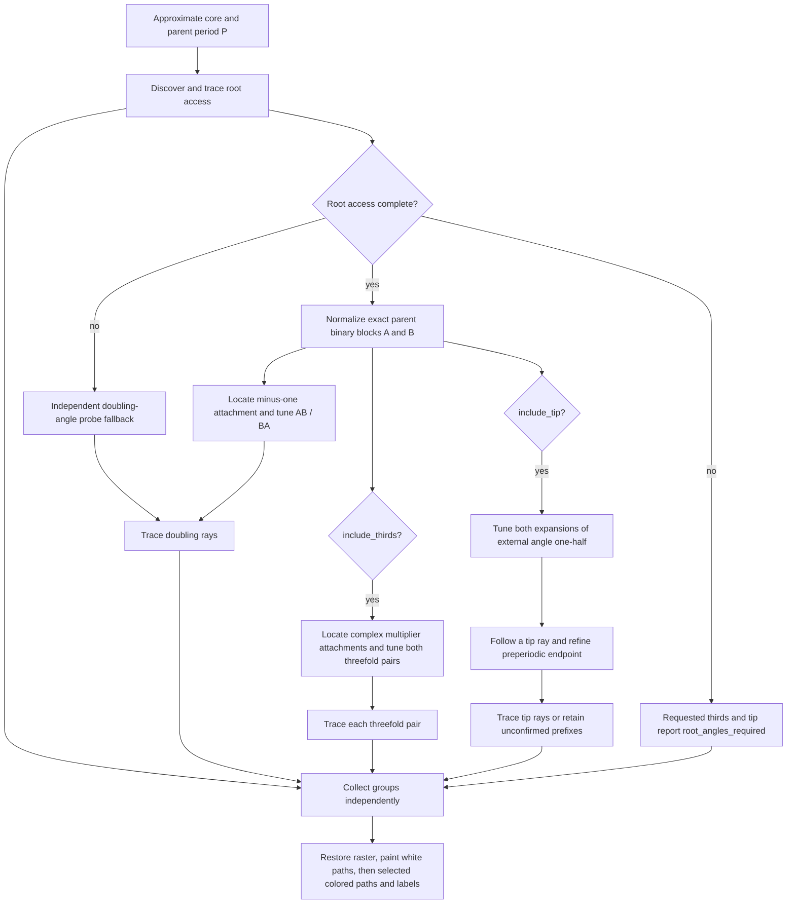

# Minibrot root and satellite parameter rays

These modules generate parameter rays in the **c plane** for a selected
period-P minibrot. The study view requests all five groups below; the SDK
facade retains root/doubling as its default unless optional groups are enabled.
Dynamic rays for a fixed c belong to the z plane and use `FractoDynamicRays.js`.

| Study row (display order)                 | Endpoint                                       | Period/pattern          | Angle construction           |
| ----------------------------------------- | ---------------------------------------------- | ----------------------- | ---------------------------- |
| Principal antenna tip (default selection) | Tuned image of c=-2, a preperiodic parameter   | No stable child pattern | 0.BAAA… and 0.ABBB…          |
| 1/2                                       | Doubling attachment, parent multiplier -1      | 2P                      | Repeating AB and BA          |
| 1/3                                       | Satellite attachment, multiplier exp(2*pi*i/3) | 3P                      | Repeating AAB and ABA        |
| 2/3                                       | Satellite attachment, multiplier exp(4*pi*i/3) | 3P                      | Repeating BAB and BBA        |
| 0/1                                       | Selected component root; +1 continuation limit | P                       | Parent characteristic angles |

A and B are length-P binary blocks obtained from completed root access. The
main cardioid uses A=0 and B=1. Entries 0/1, 1/2, 1/3 and 2/3 identify local
access/rotation relationships; canvas labels are **global external fractions**.
In particular, the local internal 1/2 doubling wake and the tip obtained by
tuning external angle 1/2 are different objects with different global angles.
The tip rays do not form a parabolic bulb wake. Bulb wake boundaries do not
outline the bulb or continue through its interior.

Ordinarily five completed groups supply ten rays. The main cardioid supplies
eight: one root ray, six satellite rays and one tip ray. Shared angles, clipped
segments and numerical failures can reduce the visible count. The detailed
[SATELLITE_RAYS.md](SATELLITE_RAYS.md) and [ANTENNA_RAYS.md](ANTENNA_RAYS.md)
guides describe the additional endpoint calculations and their limits.

## Published theoretical basis

- John Milnor, _Periodic Orbits, External Rays and the Mandelbrot Set: An
  Expository Account_, Astérisque 261 (2000), 277–333,
  [§§3, 6, 8 and Appendix B](https://numdam.org/item/AST_2000__261__277_0/):
  wakes, multiplier coordinates, satellite attachment, and tuning. A doubling
  attachment has parent multiplier -1 and child period 2P.
- Dierk Schleicher, _Rational parameter rays of the Mandelbrot set_, Astérisque
  261 (2000), 405–443,
  [published article](https://numdam.org/item/AST_2000__261__405_0/):
  periodic rational parameter rays land at parabolic parameters and the
  characteristic pair describes the corresponding wake.

The algorithms below are numerical engineering approximations to these objects;
these publications do not certify our floating-point tolerances or budgets.

## Ownership and computation

`FractoParameterAttachment.js` refines the supplied approximate core by solving
f_c^P(0)=0 **for c**, with the critical-orbit parameter derivative
u_0=0, u_(k+1)=2 z_k u_k+1. A proper-divisor return rejects an incorrect period.
Core movement is limited relative to the computed component scale. It follows
the same periodic point from multiplier 0 to the requested unit multiplier
in 64 continuation steps (-1 for doubling, exp(±2*pi*i/3) for thirds),
solving the two complex equations f_c^P(z)-z=0 and (f_c^P)'(z)=lambda.
The Jacobian includes derivatives with respect to both z and c. Closure and
multiplier residuals are checked at each step. This is separate from the SDK's
fixed-c orbital Newton solver.

`FractoParameterAngles.js` discovers root-access angles, and also supplies the
fallback doubling-angle search when verified root angles are unavailable.
It probes both tangent directions at an ordinary attachment.
For an escaping critical orbit, the parameter Green function satisfies
G(c)=lim 2^(1-k) log|f_c^k(0)|. Its outward gradient trajectories have constant
external angle. We integrate dc/d(log G) approximately as
log|z_k| z_k/u_k, using RK4 with full-step/two-half-step error control, until
|c|>10^8. There the angle of c+1/2 approximates the angle of the parameter
Böttcher coordinate. This avoids incorrectly taking a principal logarithm of
small critical iterates. Two successive shrinking probes must reconstruct the
same nearby rational numerator, within 0.03 of an integer. Root access uses
denominator 2^P-1; standalone doubling discovery uses 2^(2P)-1. Fractions are
reduced with BigInt, and both must be distinct with the requested exact period.
This searches locally around the known attachment, without enumerating every
numerator or using a table of particular periods.

`FractoParameterRayTrace.js` independently traces each rational candidate
inwards from radius 65536; `FractoParameterRays.js` collects the results.
The tracer solves f_c^k(0)=R exp(2 pi i theta) for c using
the critical-orbit derivative and the preceding point as the Newton guess.
Each dwell band uses four decreasing radii; the angle doubles exactly with
BigInt when depth increases. These finite-escape curves approximate parameter
rays; increasing escape radius or sampling sharpness is an extension point.
A ray is complete when it approaches the independently computed attachment
within the caller's tolerance. The selected-minibrot pipeline can also display
an accepted prefix that stops at any distance from the connection; its landing is explicitly
unconfirmed. A failed attempt is excluded, and each partner is retained
independently. No straight connector or invented landing segment is appended.

The worker enables both `include_thirds` and `include_tip`. Computational order
is root, doubling, 1/3, 2/3, tip; table order differs as shown above. Groups
are collected independently, but this worker posts the final result after the
whole calculation, with progress messages during computation.

### Facade and display contract

`find_minibrot_rays(core, P, options)` returns aggregate `status` and `rays`,
plus `root_access`, `doubling`, `thirds["1/3"]`, `thirds["2/3"]`, and optional
`antenna_tip`. Without either optional flag, only root/doubling are calculated
and `thirds` is empty. Each requested group retains its own status, paths and,
where available, endpoint and numerical diagnostics. Aggregate completion
requires every requested group to complete; any retained paths with a failed
group yield `partial`. With no paths the facade uses the doubling failure code;
inspect individual groups for their specific reasons.

The table columns are relative angle, pattern block, absolute fractions. The
tip has a dash for pattern because it has no stable child cardinality. The tip
is initially selected. Clicking or pressing Enter/Space on another row restores
the pristine raster, paints all paths white without labels, and paints the
selected group last in its pattern hue with iteration value 10000. This raises
lightness to about 65%, compared with about 45% at the default 255. The tip uses
the parent-period hue as a display convention. Thin dark outlines are retained.
Only selected paths receive black fraction text in white bordered edge boxes.
The table always lists all returned fractions, including incomplete paths.

Ray results are painted in the state-update completion callback so the selected
group is committed before repainting. Raster completion also triggers painting;
results arriving before or after the raster preserve the same default highlight.

## Numerical limits and result contract

`find_doubling_rays(core, P, {tolerance, on_progress, root_angles})` returns status, rays,
and, on success, root and child period. Default tolerance is 0.001 complex
units; the 500px UI supplies scope/1000, or half a pixel. Endpoint proximity
is a visual approximation, **not a computer-assisted proof of landing** or a
certified combinatorial classification. A stable reconstructed fraction alone
is insufficient to claim complete access: both inward rays must also reach
the computed attachment. Truncated paths have separate incomplete status.

The initial implementation accepts integer parent periods 1–20 and tolerances
at least 10^-12. Center/angle discovery and perturbations use native doubles;
inward tracing has a 64-decimal-digit reference orbit. It limits critical escape probes to
8192 iterates, outward integration to 12000 attempts per probe, sixteen shrinking
probes per side, and Newton solves to 40 iterations per sample. The combined
root/doubling pipeline uses inward depth max(4096, 512*P), up to 10240 at P=20.
Each optional threefold wake uses max(4096, 768*P), up to 15360 at P=20.
The low-level `trace_parameter_ray` still defaults to 4096 unless overridden. Tiny components, narrow wakes, inaccurate cores, large periods, and
slow parabolic approach can remain unresolved. Unsupported inputs, incorrect
period and unresolved core/attachment/angles return empty rays. Trace failures
and budget exhaustion may retain an accepted prefix even far from the connection,
with incomplete status; otherwise they return an empty result and reason. The period limit
protects finite-precision angle reconstruction; it is not a mathematical limit
on minibrot periods.

Tests include the main doubling pair 1/3,2/3 at -3/4; the period-two parent's
pair 2/5,3/5 at -5/4; distinct complex and real period-three parents; a period-four
parent; conjugation; incorrect periods; inaccurate cores; and trace rejection.

## Local period-one (0/1) access

`FractoMinibrotRays.js` adds the selected component's root access to the existing
doubling wake. In the renormalized minibrot coordinate this is the local 0/1
access. Its labels remain **global parameter external angles**: the main
cardioid has one ray 0/1 landing at c=1/4, while other component roots generally
have two characteristic rays. Examples are 1/3,2/3 for the period-two component,
1/7,2/7 for the rabbit, and 3/7,4/7 for the real period-three component. This
uses the multiplier-coordinate/root distinction and tuning described in
[Milnor (2000), sections 6, 8](https://numdam.org/item/AST_2000__261__277_0/), and the
root landing results in
[Schleicher (2000)](https://numdam.org/item/AST_2000__261__405_0/).
A satellite component's local root is its attachment to its parent; it need not
be a geometrical cusp. Global 0/1 is not moved to an arbitrary minibrot.

`component_attachment(core,P,+1)` follows the selected component's multiplier
from 0 to 1-10^-6. Stopping short avoids the singular equations at multiplier
+1. The resulting root is a numerical approximation (the period-one case uses
exact c=1/4). Ordinary attachments use dc/dlambda for the outward direction.
For primitive cusps, that derivative tends to zero and loses direction through
roundoff. Instead, two interior continuation samples provide the quadratic
approach ratio and an extrapolated outward direction. The displacement ratio
separates cusp-like (approximately 1/4) from ordinary (approximately 1/2)
approach in this numerical heuristic. Ordinary attachments use tangent probes. Primitive
cusps instead use probes just ahead of the cusp, with transverse offsets
proportional to 0.5 * epsilon^(3/2) / sqrt(component radius), because linear tangent probes can be inside the
component. The boundary type heuristic itself is not a certification.

Angle reconstruction uses denominator 2^P-1 and validates exact doubling
period P. Both primitive-cusp and satellite-root probes shrink by 0.8 to avoid
skipping the narrow usable exterior band; standalone doubling probes shrink
by 0.5. There are at most
16 probes per side. Each outward integration now also has an eight-million
critical-iteration work budget, so difficult probes cannot stall indefinitely.
The special P=1 access has exactly one angle 0/1; it uses the same inward
parameter-ray tracer and endpoint test, without creating a duplicate 1/1 ray.

`find_component_root_rays` returns this access independently;
`find_minibrot_rays` computes it first, then passes its verified angles to
`find_doubling_rays` for exact tuning. Both successful
results produce `complete`; if only one resolves, `partial` preserves its
complete rays or drawable incomplete prefixes. Detailed `root_access` and
`doubling` results remain available.
The UI reports partial resolution without discarding a successful ray group.
The two default groups retain independent results; the current selection-based
color and label policy is described above.

## Preserving small Newton corrections

Directly storing each Newton parameter as the full c value caused false
`trace_unresolved` failures in small minibrots. Long critical orbits amplified
roundoff in c until the target residual exceeded the acceptance threshold,
even though the computed Newton correction was smaller than one representable
step in c. The former "at this zoom" UI message incorrectly implied that
these failures established an unsupported zoom level.

`FractoParameterRaySolver.js` now computes a reference critical orbit Z_k at
the independently determined attachment r, using 64 decimal digits. It stores
native snapshots for fast iteration, while the ray solver retains delta=c-r
as its Newton state. Reference prefixes extend only as the trace requests them;
an unused deeper reference segment cannot reject an already usable prefix.
The exact quadratic identity is

    delta_z_(k+1) = 2 Z_k delta_z_k + delta_z_k^2 + delta
    z_k = Z_k + delta_z_k
    u_(k+1) = 2 z_k u_k + 1

Newton corrections update delta directly; they are not added to a much larger
c and rounded away on every step. The final canvas coordinates are projected
back to c=r+delta. A bounded four-entry reference cache shares the same orbit
between the two rays for an attachment. A nonfinite reference returns
`trace_reference`, rather than a misleading zoom error. Failed Newton/jump
checks retain depth, band step, last relative residual, last step, and reason
in result `details` for diagnostics.

This preserves the existing residual and endpoint acceptance thresholds,
iteration budgets and exact angle transport. The current display policy also
retains incomplete paths at any distance without claiming a verified landing.
It does not append artificial segments or relax closure requirements.
The representation change is an engineering derivation of the polynomial
identity above. Published context for finite-arithmetic limitations of
Bottcher-coordinate tracing is
[Romera et al. (2013), Mathematical Problems in Engineering, 105283, sections 1–3](https://doi.org/10.1155/2013/105283).
Our implementation does not use that paper's Bezier interpolation fallback.
The mathematical ray and landing basis remains the Milnor and Schleicher
publications cited above.

The cusp transverse coefficient is now 0.5 rather than 0.1. An offset that is
too small can probe the same side twice, reconstructing a duplicate angle and
rejecting root-angle discovery. Both angles must still be distinct; complete
access requires both traces to reach the independently computed attachment.

Regression cases use the supplied approximate cores at canvas-scale tolerances:

| Core                              | Parent period | Doubling fractions       | Root-access fractions |
| --------------------------------- | ------------- | ------------------------ | --------------------- |
| -0.044218945049 + 0.98657429402i  | 5             | 166/1023, 197/1023       | 5/31, 6/31            |
| -0.592462008286 + 0.621344047879i | 8             | 20818/65535, 21073/65535 | 27/85, 82/255         |

Both groups must complete and each endpoint must meet the unchanged requested
tolerance. An additional comparison with independent Decimal iteration checks
that corrections below a global-coordinate ulp remain distinct and accurate.

## Exact period-doubling angle tuning and scaled tracing budget

`FractoParameterTuning.js` implements binary substitution for the selected
component's local 1/2 wake. The theoretical basis is the tuning construction in
[Milnor (2000), section 8 and Theorem 8.2](https://numdam.org/item/AST_2000__261__277_0/),
with parameter-ray landing as described by
[Schleicher (2000)](https://numdam.org/item/AST_2000__261__405_0/).
If the verified root fractions are a/(2^P-1), b/(2^P-1), their P-bit repeating
blocks A and B substitute for 0 and 1. The local doubling angles .(01) and .(10)
therefore become .(AB) and .(BA):

    (a*2^P + b)/(2^(2P)-1)
    (b*2^P + a)/(2^(2P)-1)

Reduced fractions are restored to the common parent denominator using BigInt
before concatenation. Duplicate, incompatible and lower-period parent inputs
are rejected; period one uses its two binary symbols 0 and 1 for the single
0/1 root access. This is a general operation on the verified pair, without
registries for particular periods. It avoids a second numerical angle search
against the much finer denominator 2^(2P)-1.

`find_minibrot_rays` now solves root access first. When that pair verifies,
`find_doubling_rays` uses the tuned candidates and reports `angle_source` as
`root_tuning`. Without verified root access it retains the exterior-gradient
fallback (`gradient_probes`), preserving independent doubling results.
The multiplier-minus-one attachment and both inward endpoints are still
calculated independently. Exact angle construction does not bypass endpoint
validation or increase the accepted error.

Parabolic approach also outgrew the old fixed 4096-depth limit. Both access
groups now receive max(4096,512*P) iterations, a bounded engineering budget
rather than a theoretical convergence guarantee. The reported period-twelve
core -0.007049415229+0.806079498686i requires approximately 4900 for the doubling
pair at tolerance 0.00000833659. Its root angles 66/455 and 649/4095 tune to
2433673/16777215 and 2658898/16777215. A regression test requires completion of
both groups, exact fraction labels, unchanged endpoint tolerance, and traces
longer than the old budget permitted. All earlier period-five/eight cases
remain covered.

Partial UI results now retain the successful group and name the failed group
with its registered reason, rather than saying that either group failed.

## Incomplete traces remain visible

A numerical stop anywhere along a ray need not erase its useful exterior
portion. This is a visualization policy; it does not assert an exact
landing. The distinction follows the parameter-ray and parabolic-landing
objects in the published
[Milnor (2000), sections 3 and 6](https://numdam.org/item/AST_2000__261__277_0/)
and [Schleicher (2000)](https://numdam.org/item/AST_2000__261__405_0/), with
finite-arithmetic limitations discussed by
[Romera et al. (2013)](https://doi.org/10.1155/2013/105283).

`FractoParameterRayTrace.js` owns continuation and stopping. Its successful
result has `status: complete` and `landed: true`, meaning that the endpoint
meets the existing visual tolerance, not that mathematical landing has been
certified. Strict low-level callers retain this requirement by default.
The export from `FractoParameterRays.js` remains available for compatibility.

With `allow_partial: true`, a Newton/branch stop, reference failure or depth
budget stop may return every previously accepted continuation sample. One
accepted step is enough: the initial outer seed and that sample form a drawable
segment. The default `partial_radius` is Infinity and the minibrot callers
supply no proximity cutoff. A path is useful even when its endpoint remains far
from the expected attachment. Explicit low-level callers may still set a finite
partial radius if their own workflow requires it. Canvas clipping determines
which parts intersect the current view; unavailable segments are not invented.

The stopping attempt is never appended. Retained prefixes have
`status: incomplete`, `landed: false`, `stop_reason`, `endpoint_error` and
optional solver `details`. No endpoint connector is synthesized. Newton sample
acceptance checks remain unchanged. The line stops at the last accepted point. Its fraction label is displayed
on the canvas only when its group is selected, just as for a complete ray.

`trace_parameter_ray_group` processes partners independently and returns
`rays` plus `failures`. A group is `complete` only when every requested ray
meets the target tolerance. With any usable paths and missing/unlanded partners,
it is `incomplete`; with no paths it retains a failure status. The combined
minibrot result is `partial` when any requested group fails to complete and
at least one path remains. The UI says
"Showing available ray paths" and names the incomplete group, with an explicit
unconfirmed-landing message. Complete results keep their existing success text.

Incomplete root paths are never reused as verified characteristic angles for
exact doubling tuning. If root access is not complete, independent doubling
angle discovery remains the fallback. Tests cover numerical and budget stops,
exclusion of the failed step, independent partner retention, explicit optional proximity filtering, strict caller compatibility, and the
tuning safeguard. Additional tests require retention far from the attachment
and retention of a single accepted segment under the default display policy.

## Root confirmation inside a narrow usable band

Root-access confirmation now uses the same 0.8 radial ratio for primitive
cusps and satellite attachments. Halving cusp distances could jump directly
from a valid exterior probe into a region where outward integration cannot
resolve the angle. The two-successful-probe and 0.03 numerator-residual checks
remain unchanged. The forward cusp shape, transverse width, angular denominator,
work budgets and independent inward checks are also unchanged.

A period-sixteen regression at 0.273428557437+0.595445688613i recovers the root
angles 171/1285 and 8482/65535 and tunes them to 555885073/4294967295 and
571547938/4294967295. All four endpoints must reach tolerance 0.000005015,
without relying on incomplete-prefix acceptance. This is a sampling correction,
not a new landing criterion; the published theoretical basis remains
[Milnor (2000), sections 3, 6 and 8](https://numdam.org/item/AST_2000__261__277_0/)
and [Schleicher (2000)](https://numdam.org/item/AST_2000__261__405_0/).

The study view additionally enables `include_tip` in `FractoMinibrotRays`.
`FractoAntennaRays.js` reuses exact parent-block tuning and the parameter-ray
tracer for the principal preperiodic antenna tip. It checks a critical-orbit
relation instead of a parabolic multiplier attachment. See
[ANTENNA_RAYS.md](ANTENNA_RAYS.md) for ownership, exact fractions, limits,
partial-path handling, validation and the published Milnor/Schleicher basis.
Earlier descriptions of root and satellite groups describe that subset;
the tip is a separate fifth group.
