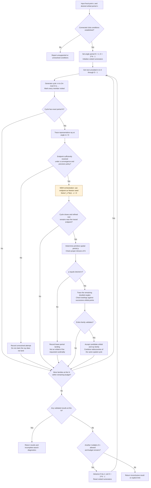
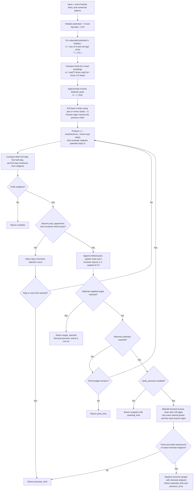

# Numerical dynamic rays

## Published theoretical basis

- John Milnor, “Periodic orbits, externals rays and the Mandelbrot set: an
  expository account,” _Astérisque_ **261** (2000), 277–333,
  [published article](https://numdam.org/item/AST_2000__261__277_0/).
  Section 2 supplies orbit portraits and angle doubling; Appendix A supplies
  the Green function and Böttcher coordinate description of external rays.
- Anna Miriam Benini and Mikhail Lyubich, “Repelling periodic points and landing
  of rays for post-singularly bounded exponential maps,” _Annales de l’Institut
  Fourier_ **64**(4) (2014), 1493–1520,
  [published article](https://doi.org/10.5802/aif.2888).
  Section 2 treats the polynomial case with connected Julia set, using inverse
  branches to establish landing at repelling periodic points. The exponential
  case is not the implementation model.

These works justify the dynamical framework. The bounded search, numerical
thresholds, budgets, and rendering decisions below are engineering choices,
not algorithms or correctness guarantees claimed by either publication.

## Reading the flowcharts

The two flowcharts below distinguish the proposed `c,n`-only discovery workflow
from the existing numerical ray tracer. The theoretical basis is the published
Milnor and Benini–Lyubich works cited above; the implementation thresholds and
stopping rules are engineering choices, not rigorous landing certificates.

Throughout these diagrams, `c` is the fixed polynomial parameter, `n` is the
desired primitive orbital period, and `N` is the angle's exact doubling period.
For an angle period `N`, `D = 2^N - 1`; it is not `2^(N-1) - 1`. Start with
`N=n`, but allow multiples of `n`: a ray can take several orbital revolutions
to return to its original angle. Doubling means modulo one, so `48/31` and
`17/31` represent the same angle. Distinct angle cycles need not correspond to
distinct spatial cycles or attracting cycles.

- [Current selected-orbital functionality](#current-selected-orbital-functionality)
- [Flowchart 1: proposed discovery from c and n](#flowchart-1-proposed-discovery-from-c-and-n)
- [Flowchart 2: implemented single-ray tracer](#flowchart-2-implemented-single-ray-tracer)
- [Result interpretation and limits](#results-and-limitations)

## Current selected-orbital functionality

The existing public operation is `find_dynamic_rays(c, {points}, options)`,
not `find_dynamic_rays(c, n)`. Missing points return `no_selection`. The detect
tab supplies points from the selected scan-table entry; cardinality is derived
from the supplied cycle and reduced to its numerically detected primitive
period. There is no random seed search in this ray operation.

| Stage                      | Current code and behavior                                                                                                                                                                                                                                                                               |
| -------------------------- | ------------------------------------------------------------------------------------------------------------------------------------------------------------------------------------------------------------------------------------------------------------------------------------------------------- |
| Receive selection          | `SeedSurveyRays.jsx` starts a worker automatically on selection/mount, or restores a cached result. Hover never supplies the ray input.                                                                                                                                                                 |
| Refine and classify        | `assess_ray_orbital()` starts Newton at the supplied first point, with up to 100 cycles at each of 64, 128, 256, and 512 digits. It requires closure error <= 1e-24 and at least one refined point within 1e-5 of that starting point. Failed closure or a branch change is rejected.                   |
| Detect primitive period    | `primitive_period()` reduces repeated point sequences using a 1e-10 coordinate tolerance. This is a numerical test, not a symbolic proof of minimal period.                                                                                                                                             |
| Check dynamical type       | The cycle multiplier is `product(2*z_i)`. Attracting and neutral/near-parabolic cycles are excluded by this tracer. Already closed near-neutral input can be classified before Newton, avoiding division by a singular derivative at an exact parabolic point.                                          |
| Check Julia-set conditions | `connectedness_evidence()` checks the fixed-point/period-two interior or a critical-orbit trapping disk. Escape is unsupported disconnected behavior; bounded iteration without sufficient trapping evidence is `unresolved`.                                                                           |
| Enumerate candidates       | `enumerate_doubling_families(N)` marks numerators visited, emits each exact-length doubling cycle once, and omits shorter divisor cycles. `N` starts at the refined orbital period `p`, then advances through `2p`, `3p`, etc.                                                                          |
| Trace and align            | `trace_ray_family()` traces the representative fraction and matches its endpoint to the nearest selected point. Subsequent doubled angles must land near the subsequent points in that same dynamical order. Cyclic shifts of stored point order are allowed.                                           |
| Validate the whole family  | Every ray must reach its terminal potential, pass 128-digit terminal agreement, land within `min(tolerance/4, 1e-6)` of its expected selected point, and pass the approach check. Angle closure and endpoint dynamics are checked before any family member is accepted.                                 |
| Publish or continue        | A failed member rejects that family immediately. Accepted complete families are published incrementally. All families at the first matching angle period are processed, subject to the shared budget; higher multiples are then skipped. If none match, try the next multiple until limits are reached. |

The family approach check compares the terminal distance with the distance of
the sample approximately 80 accepted vertices earlier; a terminal distance more
than 1.25 times that earlier distance is rejected. This is a divergence guard,
not a convergence proof. Endpoint dynamics require each `f_c(endpoint)` to be
within `tolerance/2` of the next ray endpoint.

Cancellation, late-worker-message rejection, caching, overlay visibility, and
hover restoration are owned by the UI. Those details are documented in the
[UI ray guide](../../servers/fracto-ui/src/pages/assets/surveys/RAYS.md).

## Flowchart 1: proposed discovery from c and n

**This is the requested discovery design, not the current entry-point behavior.**
Enumeration, direct ray tracing, seeded Newton refinement, and cycle-closure
checks already exist as separate helpers. The missing orchestration would use
a ray endpoint as the initial Newton seed instead of requiring precomputed
selected-orbital points. It would also need an endpoint-convergence policy
before using that seed and validation tying the refined cycle back to the ray.



Newton closure alone would not be sufficient here: solving `f_c^N(z)-z=0`
also finds shorter-period cycles, and Newton can move to another root. A
candidate must retain the intended ray association and have primitive period
`n`. The actual code currently checks association by comparison with the
already selected orbital; replacing that reference with a newly discovered
cycle is work still to be implemented. Confidence and discovery counts cannot
replace these checks. Repulsion must be classified separately from closure.

For `n=5`, enumeration starts with families `1,2,4,8,16` and
`3,6,12,24,17` modulo 31, then the other four exact-period families. One
representative is enough to start testing a family, but the current acceptance
policy traces and validates every member before accepting it. Enumerating only
`N=n` is not guaranteed to find every spatial period-`n` orbit: some have rays
whose angle period is a larger multiple. Neither exhausting a finite angle
range nor failing numerically establishes mathematical nonexistence.

## Flowchart 2: implemented single-ray tracer

This diagram corresponds to `trace_dynamic_ray()` and its internal
`inverse_point()` in [FractoDynamicRayTrace.js](FractoDynamicRayTrace.js).
It reconstructs a new inverse chain for each candidate potential; it does not
simply apply a square root to the preceding visible path point. The chain's
angles are transported by doubling, while the square-root signs are chosen
using continuity from the previously accepted chain.



`C`–`F` describe the inverse-chain evaluator used for the initial point and
for each of the three candidate-step evaluations in `H`. A cancellation request
in the outer loop returns `cancelled`; the UI can also terminate the worker.
The finite check in this implementation applies to the refined endpoint.

The exact step checks are: no inverse-chain jump above
`max(1e-12, 0.55*root_magnitude)`, direct-versus-two-half-step disagreement
<= `tolerance*0.1`, and midpoint deviation <= `tolerance` when at least one
endpoint has magnitude < 8. Failed checks halve the log-step. Step size below
`1e-7` or more than 20,000 rejected attempts ends refinement. These thresholds
are numerical heuristics, not error bounds established by the cited papers.

The standalone defaults are tolerance `0.001`, minimum potential `2^-80`, and
2,500 accepted points; terminal precision verification is opt-in. Family
validation overrides them with a quarter-pixel tolerance for the 550px span-3
survey, a multiplier-based depth between 96 and 384, 6,000 accepted points, and
`verify_precision: true`. The family caller does not supply an early target.

**`potential_limit` means the requested potential was reached; it is not a
certificate that a ray lands or that its endpoint is a periodic point.** The
family caller additionally tests proximity to its selected cycle, approach,
angle closure, and endpoint dynamics. The standalone helper does not solve a
periodic-point equation and does not discover an orbital by itself. The
128-digit check uses the Number-converted parameter, so it does not restore
parameter digits already lost during conversion.

## Domain and ownership

These are **dynamic-plane** rays for the fixed polynomial `f_c(z)=z²+c`, drawn
on the seed survey. They are not parameter-plane rays or Mandelbrot wake
boundaries. An orbit's confidence and discovery count neither establish
repulsion nor determine its external angles.

`FractoRayEligibility.js` refines the selected cycle with 64, 128, 256, then
512-digit Newton arithmetic as necessary, requires residual <= 1e-24, rejects a
branch displacement > 1e-5, reduces repeated traversals, and computes
`lambda = product(2*z_i)`. Attracting cycles have no external landing rays;
neutral/near-parabolic cycles require specialized handling and are unsupported.
The neutral band is `abs(log(abs(lambda))) <= approximately 1e-6`.

Connectedness evidence comes from an attracting fixed point, the interior of
the period-two disk, or a propagated trapping disk containing the critical
orbit after at most 2,048 iterates. Escaping critical orbits identify unsupported
disconnected cases. Bounded critical iteration alone is deliberately inconclusive.
Disk arithmetic includes a numerical margin, but is not interval arithmetic:
this is numerical evidence, not a certified connectedness proof.

`FractoRayFamilies.js` enumerates exact-period angle cycles generally. For an
angle period `n`, use `D = 2^n - 1` and repeatedly apply `k -> 2*k mod D`.
A bitset marks every numerator already visited, so cyclic rotations of a
previous family are never emitted again. Cycles shorter than `n` are omitted;
this matters when `n` is composite. For `n=1`, the family is `0/1`.

For example, period five has six families, including `1,2,4,8,16` and
`3,6,12,24,17` modulo 31. Period seven has 18 families, with no special case
for `5/127`. Enumeration uses exact native integers within the supported
period range 1–24, and reduces displayed fractions with BigInt arithmetic.
This construction follows Milnor's angle-doubling framework cited above.
Distinct angle families do not guarantee distinct spatial orbitals or attraction:
several rays can land on one point, and angle period can exceed orbital period.

`FractoDynamicRays.js` starts with angle period equal to the selected cycle's
refined primitive period `p`. It tests each distinct family by tracing its first
ray, matching the landing to any selected point, then validating the whole
family in dynamical order. If no family matches, it tries angle periods `2p`,
`3p`, etc., through the configured maximum (default 24). This preserves cases
such as two or three rays landing on a fixed point. It completes the first
matching angle period and stops; it does not claim to find every higher-period
access. All completed members of a family must pass landing/precision/dynamics
checks before that family is accepted.

There is no dyadic sampling, angular subdivision, speculative nearby-angle
screening, fixed-family registry, or broad-search fallback. The default budget
is 256 candidate families, configurable via `options.max_families` up to 4,096.
The angle-period cap is configurable via `options.max_angle_period`, bounded
at 24. These bounds are engineering choices, not theoretical restrictions.
Cancellation is checked during enumeration and tracing; the UI can terminate
the worker immediately. A budget limit without validated rays returns
`family_limit`, which does not assert nonexistence. Diagnostics use
`strategy: "doubling_families"`, zero discovery evaluations, actual candidate
counts, limits, and `budget_reached`/`exhausted` flags.

`FractoDynamicRayTrace.js` starts in the exterior at Green potential 8,
using `phi^-1(w) = w - c/(2w) + O(w^-3)`, and continues inverse square-root
branches inward. Step halving checks branch continuity, midpoint curvature,
and agreement between a full step and two half steps. Geometry tolerance is
one quarter of a pixel in the 550px, span-3 survey. Exact BigInt fractions
transport angles through doubling without loss of combinatorial identity.
Terminal inverse chains are checked again with 128-digit arithmetic and exact
rational phase. The terminal depth adapts to the multiplier, between 96 and
384 doublings; a ray has at most 6,000 vertices.

Accepted rays must reach within `min(tolerance/4, 1e-6)` of their refined
landing point, approach it rather than diverge, pass terminal precision
agreement, and obey the endpoint dynamics under angle doubling. These are
numerical validation checks, not rigorous landing proofs. No straight segment
is appended to force a curve to meet its expected landing point. Failed or
incomplete candidates are omitted, rather than displayed as successful rays.

## Results and limitations

`find_dynamic_rays(c, {points}, {on_progress, cancelled})` reports classification,
then a `doubling_families` progress stage. A result contains accepted polylines,
exact fraction angles, point indices, landing/precision errors, multiplier,
connectedness evidence, and bounded-search diagnostics. `search.complete` is
always false: even a successful search does not claim to find all landing rays.

Statuses distinguish missing/invalid input, failed closure, branch changes,
attracting/neutral cycles, disconnected/unresolved Julia sets, period limits,
cancellation, family-budget limits, no validated rays, and successful approximations. `no_rays` means
only that the budgets and numerical checks found none. Very slow landing,
near-critical paths, many candidate families, or high angle periods can exceed
the numerical/enumeration budgets. Orbital refinement preserves decimal parameters, but ray geometry uses
Number-valued coordinates/parameters; the 128-digit terminal check verifies
that numerical parameter, not additional decimal input digits. More digits cannot repair a missed angle or prove completeness.

The detect tab runs this work in its own terminable Web Worker. Table scanning,
hover, canvas data loading, and tracing have independent ownership. See the UI
survey RAYS.md for interaction and overlay details.

## API use and result interpretation

With an existing selected cycle, the current operation is:

```js
import { find_dynamic_rays } from "@fracto/sdk/orbitals/FractoDynamicRays.js";

// c and selected.points come from the detect tab's table selection.
const result = await find_dynamic_rays(
  c,
  { points: selected.points },
  {
    max_angle_period: 24,
    max_families: 256,
    on_progress: (progress) => update_progress(progress),
    cancelled: () => job_cancelled,
  },
);
```

Without an existing orbital, tracing one specified fraction is already possible:

```js
import { rational_angle } from "@fracto/sdk/orbitals/FractoRayGeometry.js";
import { trace_dynamic_ray } from "@fracto/sdk/orbitals/FractoDynamicRayTrace.js";

const ray = trace_dynamic_ray(c, rational_angle(3, 31), {
  minimum_potential: 2 ** -96,
  max_points: 6000,
  verify_precision: true,
});
// ray.endpoint is a numerical path endpoint, not an accepted orbital.
```

The second example is a single-ray operation, not the proposed discovery
pipeline. Its chosen potential is a caller budget, not a guaranteed landing
accuracy. It does not automatically invoke Newton, reduce primitive period,
or return a validated cycle. Cancellation callbacks are cooperative; a browser
worker provides immediate termination when the user cancels.

| Result status                                        | Meaning in the current pipeline                                                                                                                                            |
| ---------------------------------------------------- | -------------------------------------------------------------------------------------------------------------------------------------------------------------------------- |
| `invalid_input` / `no_selection` / `invalid_orbital` | Invalid focal coordinate, absent selected points, nonfinite points, or more than 256 supplied points.                                                                      |
| `closure_failed` / `branch_changed`                  | The selected orbital could not be refined to ray eligibility accuracy or refinement moved away from the selected solution.                                                 |
| `attracting` / `neutral`                             | Not a supported repelling target; neutral and near-parabolic tracing require specialized handling.                                                                         |
| `disconnected` / `unresolved`                        | Critical escape or insufficient connected-Julia evidence under the current policy. These are capability/evidence outcomes, not a general prohibition on all external rays. |
| `period_limit`                                       | The selected primitive period exceeds the allowed angle-period range.                                                                                                      |
| `family_limit`                                       | The candidate budget was reached without accepted rays.                                                                                                                    |
| `no_rays`                                            | No family passed within the tested angle-period range and numerical budgets.                                                                                               |
| `rays_found`                                         | At least one full family passed; more families/accesses may exist. This status can coexist with `search.budget_reached` if a later candidate hit the cap.                  |
| `cancelled`                                          | The caller cancelled enumeration or tracing; no accepted result is returned by this operation.                                                                             |

Progress reports the `classifying` stage, followed by `doubling_families` with
`processed`, `total`, and accepted `rays`. The total is the lesser of the family
budget and the family count across allowed angle periods; successful completion
can stop before that total when the first matching angle period is finished.
It is not a count of pixels, seeds, or individual ray vertices.

The result's `search.candidates` counts attempted families and `search.rejected`
counts failed families. `search.evaluations` remains zero because the former
angular-discovery stage no longer runs. `search.exhausted` refers to the
configured enumeration range; it is false when work stops on success or a
family limit. `search.complete` remains false even if the configured range
was exhausted: the range and numerical acceptance tests do not constitute a
proof that all landing rays have been found.

The UI additionally has `idle`, `running`, `unavailable`, and `failed` states.
Worker creation failures and calculation exceptions become those UI messages;
they are not mathematical classification results. The UI caches up to eight
completed selection results, keyed by focal point and full selected point list.
A repeated trace for an unchanged cached selection restores that result.

## Verification

`node --test test/sdk_dynamic_rays.test.js` covers exact angle transport,
analytic radial rays for `c=0`, the basilica fixed point's 1/3 and 2/3 accesses,
a period-three orbit, the rabbit fixed point's three accesses, primitive-period
reduction, cancellation, unsupported classifications, and general family
validation across focal parameters and cyclic reorderings. Enumeration tests
cover period-five examples, composite-period exclusion, and duplicate avoidance. These examples follow
the dynamic-ray/orbit-portrait framework of the published works cited above.
